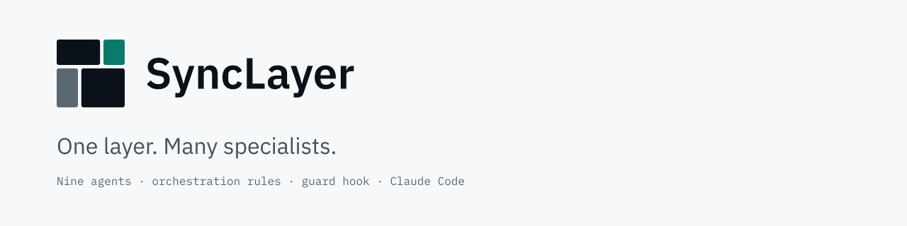

<picture>
  <source media="(prefers-color-scheme: dark)" srcset="assets/brand/banner-dark.svg">
  
</picture>

# SyncLayer

**One layer. Many specialists.**

SyncLayer is a versioned layer of nine specialist agents, orchestration rules and a guard hook for Claude Code. One session orchestrates; agents never delegate to each other. The guard is a heuristic, not a sandbox, and this repository documents exactly where it stops.

Infraestructura global de agentes especializados para Claude Code. Identidad y voz del proyecto: [`docs/brand/`](docs/brand/brand-strategy.md).

Este repositorio es la copia versionada de un ecosistema de nueve subagentes de
Claude Code, sus reglas de orquestación y un hook de seguridad. Claude Code lee los
archivos vivos desde la carpeta personal (`~/.claude/`); este repositorio es la copia
que se versiona. Se instala con `install.ps1`, que copia doce archivos dentro de
`~/.claude/` (ver «Instalación»).

La orquestación tiene forma de estrella: sólo la sesión principal decide a qué agente
llamar y le pregunta al usuario. Los agentes no se delegan trabajo entre sí y no
pueden hacer preguntas al usuario.

## Requisitos

- Claude Code (las verificaciones se hicieron con 2.1.310).
- Python 3.12 en el PATH del shell que lanza los hooks (lo necesita
  `hooks/agent_guard.py`; usa sólo la biblioteca estándar).
- Para instalar: Windows PowerShell 5.1. Es el único entorno verificado (ver «Límites del
  instalador»).

## Estructura

```
SyncLayer/
├── install.ps1        Instalador (Windows PowerShell 5.1)
├── install-manifest.json  Manifiesto: los doce archivos que se instalan y su hash
├── tools/
│   ├── build_manifest.py  Genera y comprueba el manifiesto
│   └── usage_report.py    Reporte de uso de subagentes (se ejecuta desde el clon)
├── agents/            Un archivo por agente (frontmatter + prompt)
│   ├── oracle.md  scout.md  atlas.md  forge.md  sentinel.md
│   └── auditor.md  shield.md  debugger.md  scribe.md
├── rules/
│   └── agentes.md     Reglas de orquestación (se cargan en todos los proyectos)
├── hooks/
│   └── agent_guard.py Hook PreToolUse que limita lo que escriben los agentes
├── assets/
│   └── brand/         SVG de marca (símbolo, wordmark, lockups, favicon, banner,
│       │              catálogo, estrella, slides, hoja de marca), PNG/ICO exportados
│       │              y generadores
│       └── src/       build_brand.py, build_round2.py, build_round3.py, brandlib.py,
│                          fonts_util.py, agents_data.py, ico.py, export_social_png.py,
│                          export_favicons.py
├── docs/
│   ├── agentes.md     Guía de uso y mantenimiento
│   ├── brand/         Estrategia, voz e identidad visual del proyecto
│   └── plans/         Planes de implementación y backlog
└── tests/
    ├── test_agent_guard.py
    ├── test_brand_agents.py
    ├── test_ico.py
    ├── test_install.py
    ├── test_levels.py     Tabla de niveles, marcadores del README, guarda de promesas
    ├── levels_ref.py      Lector de la tabla y del estado esperado (auxiliar de las pruebas)
    ├── test_manifest.py
    ├── test_usage_report.py
    ├── test_usage_report_cli.py
    ├── test_usage_report_edges.py
    ├── test_usage_report_perf.py  Equivalencia y tope de trabajo del lector de transcripciones
    └── usage_synth.py     Transcripciones sintéticas para las pruebas del reporte
```

## Assets de marca

`assets/brand/` guarda los SVG finales (con variantes dark, light y monocromas) y los
scripts que los generan. Los SVG se regeneran, no se editan a mano; cómo, en
[`CLAUDE.md`](CLAUDE.md). Reglas de uso y de tamaño mínimo:
[`docs/brand/visual-identity.md`](docs/brand/visual-identity.md).

Contenido de `assets/brand/`:

- Símbolo `symbol-*` y variante de 16 px `symbol-16-*`; wordmark `wordmark-*`; lockups
  `lockup-horizontal-*` y `lockup-stacked-*` (cada uno en dark, light, mono y mono-reverse).
- Favicon: `favicon.svg` (un solo archivo; cambia de colores con `prefers-color-scheme`),
  `favicon-16.png`, `favicon-32.png`, `favicon-48.png`, `favicon.ico` (PNG de 16, 32 y 48 px
  embebidos) y `apple-touch-icon.png` (180×180). Los PNG llevan el símbolo dark sobre un
  fondo `bg` opaco (con 8 px de margen a 32 y 48 px; el de 16 px no tiene margen). El repositorio no tiene sitio web: estos archivos están listos para usarse
  si algún día lo hay, pero hoy no se enlazan desde ningún sitio.
- `banner-*`, `social-preview` (SVG y PNG), `agent-catalog-*`, `architecture-star-*` y tres
  slides.
- `brand-sheet-{dark,light}.svg` (1600×1131): hoja de marca de una página con símbolo, lockup,
  paleta, tipografía y reglas de uso.

**Social preview.** GitHub no permite subirla desde un commit: carga
`assets/brand/social-preview.png` (1280×640) a mano en el repositorio, en
Settings > Social preview.

## Instalación

`install.ps1` copia a `~/.claude/` doce archivos, los que lista `install-manifest.json`:
los nueve `agents/*.md`, `rules/agentes.md`, `hooks/agent_guard.py` y `docs/agentes.md`.
No instala `docs/brand/`, `assets/`, `tests/` ni `tools/` (tampoco `tools/usage_report.py`:
el reporte de uso se ejecuta desde el clon). Sólo escribe esos doce
destinos, sus temporales, el archivo de estado y el respaldo; no borra nada y no toca
archivos ajenos (`hooks/caveman-statusline.ps1`, `settings.json`, `CLAUDE.md`...). El
instalador no crea, lee ni borra `synclayer-usage.md`.
Escribe los archivos con finales de línea LF, vengan del árbol de trabajo con CRLF o con LF.

Instálalo sólo desde un clon cuyo commit hayas revisado (ver «Límites del instalador»). Desde la raíz del repositorio, en Windows PowerShell 5.1:

```powershell
# 1. Ensayo: muestra el plan y no escribe nada
powershell -NoProfile -ExecutionPolicy Bypass -File .\install.ps1 -DryRun

# 2. Instalación real
powershell -NoProfile -ExecutionPolicy Bypass -File .\install.ps1
```

`-ExecutionPolicy Bypass` vale sólo para ese proceso; no ejecutes `Set-ExecutionPolicy`.
Una directiva de grupo (`MachinePolicy` o `UserPolicy`) tiene precedencia sobre
`-ExecutionPolicy`: si tu equipo la define, el parámetro no la anula.
Con `Bypass`, PowerShell no comprueba la marca de origen web (Mark-of-the-Web): si el
repositorio vino en un ZIP descargado, esa comprobación se salta. Lee `install.ps1`
antes de ejecutarlo.

Parámetros:

| Parámetro | Por defecto | Efecto |
|---|---|---|
| `-Target` | `~/.claude` (`Join-Path $HOME '.claude'`) | Carpeta de destino. Útil para probar contra una carpeta temporal |
| `-BackupDir` | `<Target>-backup-<yyyyMMdd-HHmmss>` (hermano del destino, p. ej. `~/.claude-backup-20261119-153000`) | Carpeta de respaldo. Debe ser una carpeta nueva y no estar dentro de `-Target`; si hay algo que respaldar y ya existe, el instalador sale con 1 |
| `-DryRun` | apagado | Muestra el plan y sale sin crear `-Target`, `-BackupDir` ni ningún archivo |
| `-Force` | apagado | Permite sobrescribir archivos con cambios locales, siempre con respaldo |

Qué hace, en orden (los pasos 1 a 5 no escriben nada):

1. Valida `install-manifest.json`: `schema` 1, `algorithm` `sha256` y que cada ruta cumpla la
   lista permitida (cualquier `agents/[a-z0-9_-]+.md`, hoy nueve, más `rules/agentes.md`,
   `hooks/agent_guard.py` y `docs/agentes.md`); rechaza rutas duplicadas, absolutas, con `..`,
   `\` o `:`.
2. Verifica el origen: el hash canónico (SHA-256 con CRLF convertido a LF) de cada archivo
   debe coincidir con el manifiesto.
3. Lee el estado previo `<Target>/synclayer-manifest.json`. Si no se puede leer o no es
   válido, lo trata como ausente, avisa por stderr y no lo respalda (se reescribe sin respaldo).
4. Clasifica cada archivo por el hash del destino. El plan muestra una línea `ESTADO  ruta`
   por archivo y un resumen:

   | Estado | Condición | Acción |
   |---|---|---|
   | `NUEVO` | El destino no existe | Copia |
   | `IGUAL` | El hash del destino coincide con lo que se escribiría para el nivel (el manifiesto, en el nivel 5) | Nada |
   | `ACTUALIZAR` | Distinto, y coincide con lo que instaló la ejecución anterior (por ejemplo, un cambio de nivel con los archivos intactos) | Respalda y copia |
   | `MODIFICADO` | Distinto, y sin estado previo o con un hash que no es el de la ejecución anterior | Sin `-Force`: aborta con exit 3 y no escribe nada. Con `-Force`: respalda y copia |
   | `HUERFANO` | Estaba en el estado previo y ya no está en el manifiesto, o ya no es el destino actual de su rol (cambio de nombre con alias) | Sólo informa; no lo borra. Si es un cambio de nombre y el archivo existe, avisa por `stderr` con el destino nuevo |

5. Con `-DryRun` termina aquí: sale con 0, o con el 1, 2 o 3 que habría dado la ejecución real.
6. Respalda en `-BackupDir`, con la misma ruta relativa, lo que va a sobrescribir (y el
   estado previo si lo va a reescribir y era válido), y verifica cada copia del respaldo. Un
   estado ilegible o inválido se reescribe sin respaldo. La carpeta de respaldo sólo se crea
   si hay algo que respaldar y nunca se pisa un respaldo.
7. Copia primero `hooks/agent_guard.py` y después el resto, cada archivo mediante un
   temporal en la misma carpeta y un movimiento sobre el destino.
8. Verifica el hash de lo escrito (con el nivel 5, contra el manifiesto; con 1 a 4, contra lo
   esperado para el nivel).
9. Escribe `<Target>/synclayer-manifest.json`, el estado con esquema 2 (por archivo: el hash del
   origen, el de lo escrito y el nivel; lee también el esquema 1 de las
   instalaciones anteriores y lo migra), sólo si todo lo anterior salió bien. Sin él, el instalador no distingue una versión anterior de
   SyncLayer de una edición a mano, y todo archivo distinto sale `MODIFICADO`.
10. Imprime los conteos, la ruta del respaldo y los recordatorios (reiniciar sesiones,
    `settings.json` y `CLAUDE.md` sin tocar, sin sincronización automática).

Primera instalación sobre una copia manual: sin estado previo, todo archivo distinto sale
`MODIFICADO`. Haz el `-DryRun`, mira qué difiere y decide: llevar el cambio al repositorio
(ver «Dos copias, sin sincronización automática») o repetir con `-Force`, que respalda y
sobrescribe.

Códigos de salida:

| Código | Significado | ¿Se escribió algo? |
|---|---|---|
| 0 | Correcto, incluido «nada que hacer» y `-DryRun` sin problemas | Sólo en ejecución real |
| 1 | Uso o entorno: manifiesto ausente o inválido, `synclayer-config.json` inválido o ilegible, frontmatter de un agente que no se puede renderizar para el nivel (también con `-DryRun`), ruta no permitida, punto de reanálisis o archivo bloqueado detectados antes de escribir, respaldo que ya existe, `-Target` que es un archivo o una raíz de unidad sin `-BackupDir`, error no previsto | No (salvo fallo de E/S al crear el respaldo) |
| 2 | El origen no coincide con el manifiesto | No |
| 3 | Hay `MODIFICADO` y falta `-Force` | No |
| 4 | Falló la copia, la verificación posterior o la escritura del estado | Sí, parcial; el respaldo queda y no hay rollback |

Tras un exit 4, corrige la causa y repite: reinstalar es seguro. Si el exit 4 ocurrió después
de crear el respaldo y la repetición vuelve a tener algo que respaldar, repetir con el mismo
`-BackupDir` explícito sale 1 porque la carpeta ya existe: usa otro `-BackupDir` o ninguno.

Qué no hace: no sincroniza automáticamente, no borra nada, no toca `settings.json` ni
`~/.claude/CLAUDE.md`, no hace rollback, no autentica el origen y no crea, edita, respalda ni
borra `synclayer-config.json`. El único entorno verificado es Windows PowerShell 5.1.

**Estado del instalador (esquema 2).** `<Target>/synclayer-manifest.json` ya no es una copia del
manifiesto. Lleva `schema` 2, `algorithm` `sha256`, `eol` `lf` y, por archivo y en el orden del
manifiesto, `path`, `sha256` (hash canónico del origen), `written` (hash canónico de lo escrito) y
`level` (el nivel leído de la configuración). El formato es siempre el esquema 2, también con
el nivel 5; con el nivel 5 `written` es igual a `sha256`, y con 1 a 4 es distinto para los seis agentes cuya celda cambia el archivo. Es ASCII, con LF y un salto final, y reinstalar sin cambios no lo
reescribe. La clasificación compara el destino con `written`, no con el origen de la ejecución
anterior. Un estado de esquema 1 (el de la Fase 1) es válido: se migra a esquema 2 en la primera
reinstalación y el viejo va al respaldo, así que esa reinstalación crea una carpeta de respaldo
aunque todos los archivos salgan `IGUAL`. Un estado de otro esquema, ilegible o inválido se trata
como ausente (con aviso por `stderr`, sin respaldo) y nunca produce `ACTUALIZAR`.

**Configuración y avisos.** Tras verificar el origen (pasos 1 y 2) y antes de leer el estado
previo, el instalador lee `<Target>/synclayer-config.json` y, con un nivel de 1 a 4, avisa por
`stderr` si el entorno define `CLAUDE_CODE_SUBAGENT_MODEL_FORCE` o `CLAUDE_CODE_EFFORT_LEVEL`. Con un
nivel de 1 a 4 escribe después el `model:` y el `effort:` de seis agentes. Ver «Niveles» (qué se
acepta, qué avisos salen y qué falta).

Después, las instrucciones globales del usuario (`~/.claude/CLAUDE.md`) deben apuntar
a las reglas. Las reglas de `~/.claude/rules/` se cargan en todos los proyectos. Ejemplo
de fragmento:

```markdown
## Ejecución de planes

Delega según el tamaño de la tarea con los agentes globales descritos en
`~/.claude/rules/agentes.md`.
```

Las sesiones que ya estaban abiertas al instalar no ven los agentes nuevos: reinícialas.

### Dos copias, sin sincronización automática

Editar los archivos vivos de `~/.claude/` no actualiza este repositorio, y editar el
repositorio no actualiza `~/.claude/`. Repositorio -> `~/.claude` lo hace `install.ps1`
cuando lo ejecutas; `~/.claude` -> repositorio es manual, como sigue. El manifiesto detecta
deriva, corrupción y ediciones sin regenerar; no autentica el origen. Haz respaldo del
destino antes de sobrescribir.

`~/.claude` -> repositorio: copia sólo los archivos de SyncLayer, nunca con comodines.
`~/.claude/agents/`, `hooks/` y `docs/` contienen archivos que no son de SyncLayer
(por ejemplo `hooks/caveman-statusline.ps1`); este repositorio es público y no deben
entrar. Desde la raíz del repositorio:

```powershell
foreach ($f in (git ls-files agents rules hooks docs/agentes.md)) {
    Copy-Item "$HOME\.claude\$f" ".\$f" -Force
}
git status   # revisa el diff antes de commitear
```

Tras copiar un archivo gestionado al repositorio, regenera el manifiesto (ver
«Mantenimiento»). Ojo con `tests/`, `tools/` y `install.ps1`: sólo existen en el repositorio.

## Uso

- **Automático.** Claude delega según el tamaño de la tarea, con las reglas de
  `rules/agentes.md`. Las tareas triviales no usan agentes.
- **Por nombre.** «Usa a forge para…», o `@agent-forge` en el prompt.
- **Listar.** `/agents` dentro de Claude Code muestra los agentes registrados.
- **Diagnóstico.** `claude --debug` muestra campos de frontmatter no reconocidos.

### Flujos por tamaño

| Tamaño | Flujo |
|---|---|
| Trivial | Sesión principal, sin agentes |
| Mediana | `oracle` (si el área es desconocida) -> `forge` -> `auditor` |
| Grande | `oracle` y `scout` (si hace falta) -> `atlas` -> aprobación del usuario -> por task: `forge` -> `auditor` -> al final: `sentinel` -> `shield` (si aplica) -> `scribe` -> `auditor` sobre el cambio completo |
| Bug sin causa clara | `debugger` -> `forge` -> `sentinel` |

Resumen de las reglas (detalle en [`rules/agentes.md`](rules/agentes.md)):

- En paralelo sólo corren agentes que no escriben (`oracle`, `scout`, `auditor`, `shield`).
- Un solo agente que escribe (`forge`, `sentinel`, `scribe`) a la vez por checkout.
- Precedencia ante conflictos: `shield` > `sentinel` > `auditor` > plan de `atlas` > `forge`.
- Una tarea está terminada cuando las pruebas relevantes se corrieron y pasaron, los
  criterios de aceptación están verificados, no quedan hallazgos Critical ni Important
  sin resolver y la documentación está al día.

## Catálogo

| Agente | Rol | Modelo | Herramientas |
|---|---|---|---|
| `oracle` | Analista de proyecto, sólo lectura | `haiku` | Read, Grep, Glob |
| `scout` | Investigación en fuentes oficiales | `sonnet` | WebSearch, WebFetch, Read, Grep, Glob |
| `atlas` | Planificador y arquitecto | `claude-fable-5-2` | Read, Grep, Glob, Write |
| `forge` | Desarrollador | `sonnet` | Read, Edit, Write, Grep, Glob, Bash |
| `sentinel` | QA | `sonnet` | Read, Grep, Glob, Bash, Edit, Write |
| `auditor` | Code review independiente | `opus` | Read, Grep, Glob, Bash |
| `shield` | Seguridad | `opus` | Read, Grep, Glob, Bash |
| `debugger` | Causa raíz | `opus` | Read, Grep, Glob, Bash |
| `scribe` | Documentación | `sonnet` | Read, Grep, Glob, Edit, Write |

La columna de modelo es la del nivel 5, el repositorio tal cual (ver «Niveles»).

Los alias (`haiku`, `sonnet`, `opus`) los resuelve Claude Code a la versión vigente de
cada familia. `atlas` va fijado al ID `claude-fable-5-2` porque, con Claude Code
2.1.310, el alias `fable` resolvía a Fable 5.1. Esa versión del CLI muestra un aviso
`unrecognized_model` para el ID fijado, pero la API lo acepta y la sesión corrió con
ese modelo.

Ningún agente tiene acceso a conectores MCP: la lista `tools` de cada uno es explícita.

## Hook de seguridad: `hooks/agent_guard.py`

Guarda `PreToolUse` enlazada desde el frontmatter (`hooks:`) de cuatro agentes:

| Agente | Matcher | Comando |
|---|---|---|
| `sentinel` | `Write\|Edit\|NotebookEdit\|Bash` | `python "$HOME/.claude/hooks/agent_guard.py" tests-only` |
| `auditor`, `shield`, `debugger` | `Bash` | `python "$HOME/.claude/hooks/agent_guard.py" readonly --allow-temp` |

Contrato: lee un JSON por stdin (`tool_name`, `tool_input`, `cwd`). Sale con 0 para
permitir y con 2 para bloquear; en ese caso escribe el motivo, en español, por stderr.
Falla cerrado: entrada inválida, modo desconocido, cualquier error interno y comandos
de más de 100 000 caracteres terminan en bloqueo.

- `tests-only`: `Write`, `Edit` y `NotebookEdit` sólo pasan sobre artefactos de pruebas
  (carpetas de pruebas, `test_*.py`, `*.test.*`, `*.spec.*`, `conftest.py`, etc.). Las
  carpetas se evalúan sobre la ruta relativa al `cwd` del payload; una ruta absoluta
  fuera de `cwd` (o sin `cwd`) sólo vale si es temporal. Quedan excluidas `.git`,
  `.github`, `.claude`, `.vscode`, `.idea`, `.husky`, `.venv`, `venv`, `site-packages`
  y `node_modules`.
  Para `Bash`, `tests-only` es **estricto**: sólo acepta comandos simples. Rechaza
  `$`, backticks, `\` (salvo `\;`), paréntesis, llaves (salvo `{}`), `[[`, heredocs,
  comandos de varias líneas, globs con corchetes, comentarios y caracteres de control,
  porque el parser no puede emularlos con certeza. Escribir sólo se permite hacia rutas
  de pruebas bajo `cwd` o temporales. Un `cd` anula las rutas relativas. Escribe un
  comando simple por llamada, con rutas literales y `/` como separador.
- `readonly`: bloquea git que modifica, comandos que modifican archivos, editores
  in situ, instalación de paquetes y redirección de salida a archivos.
  `--allow-temp` permite escribir sólo bajo directorios temporales.

### Límites

Es una heurística contra escrituras accidentales, **no un sandbox**.

- **`sentinel` tiene guarda en `Bash` desde el modo estricto de `tests-only`, pero sigue
  siendo una lista negra.** Escribe en rutas de pruebas y bloquea los escritores
  habituales, no todos. Sin sandbox, un runner de pruebas ejecuta código del repositorio
  y puede escribir donde quiera. «Sólo escribe tests» es heurístico.
- `auditor`, `shield` y `debugger` no son de solo lectura real: deben correr tests y
  builds, y eso ejecuta código arbitrario. Tampoco hay restricción de lectura (`.env`)
  ni de red (`curl -d @archivo URL`).
- El modo `readonly` es una lista negra con parser parcial de shell, no estricto. Pasan,
  entre otros, comandos que ejecutan o escriben por vías no listadas: `python script.py`,
  `$(echo rm) x`, `c=rm; $c x`, `busybox rm`, `awk '{print > "f"}'`,
  `GIT_EXTERNAL_DIFF=... git diff`, `docker run`, `ssh`, `iex`, `sqlite3`/`psql`/`mysql`
  con `DROP`.
- Huecos confirmados en la revisión final y no corregidos (`tests-only` y `readonly`):
  `tar` con `--checkpoint-action`/`--remove-files`/`--index-file`, `openssl rand -out` y
  `openssl base64 -d -out`, `xxd --revert`, `vim -c`/`+cmd`, `sed -f script` (el comando
  `e`), `cp` con `nullglob` y varios orígenes, variables que cambian la configuración de
  git (`HOME`, `XDG_CONFIG_HOME`), `export` sin `=`, `PS4` y `let`/`printf -v` con
  sustituciones en comillas simples, y los puntos y espacios finales de nombres de
  carpeta en Windows (`.claude./`).
- Brechas conocidas y aceptadas: `python -c`, `node -e`, `bash -c`, `eval`, `xargs rm`,
  `cmd /c`, `python -m venv`. Tampoco cubre `wget -o`/`-a` ni `curl -D`/`-c`/`--trace`.
- Si `python` no está en el PATH del shell que lanza el hook, el shell sale con 127 y
  Claude Code deja pasar la llamada (falla abierto). Lo mismo si `python` resuelve al
  alias de la Microsoft Store (`...\WindowsApps\python.exe`). Comprueba antes de
  confiar en la guarda:

  ```powershell
  Get-Command python -All | Select-Object Source   # el primero debe ser un Python real
  python -B -c "import sys; print(sys.version)"     # debe imprimir la versión, no un aviso
  ```
- Los hooks del frontmatter de agentes de usuario corren sin el diálogo de confianza
  del espacio de trabajo.

## Límites del instalador

Riesgos residuales conocidos, verificados en revisión de seguridad y de código.

**Integridad, no autenticidad**

- El manifiesto vive en el mismo repositorio que los archivos: da integridad, no
  autenticidad. Un clon o un PR malicioso con el manifiesto regenerado instala, sin aviso,
  una `agent_guard.py` debilitada o agentes sin `hooks:`. Instala sólo desde un clon cuyo
  commit hayas revisado (`git log -p -- hooks/ agents/`).
- Un exit 2 se resuelve revisando `git status` y `git diff` y restaurando el archivo.
  Regenerar el manifiesto es cosa de los mantenedores, no de quien instala.
- La lista permitida acepta cualquier `agents/<nombre>.md`; qué archivos se instalan lo fija
  el manifiesto del repositorio.

**Códigos de salida por fase**

- Un punto de reanálisis o un bloqueo detectados antes de escribir en el destino dan exit 1.
  Los detectados durante o después de escribir (copia, verificación, estado) dan exit 4.

**Enlaces y rutas**

- La carrera con enlaces no se cierra: si un enlace aparece mientras se escribe, un archivo
  puede quedar escrito fuera de `-Target`. Se informa con exit 4 y nunca se borra.
- Un `-Target` que es enlace simbólico o junction se rechaza (exit 1). Un `~/.claude` que es
  un enlace a un repositorio de dotfiles se rechaza igual: pasa `-Target` con la ruta real.
  Con ese `-Target` el instalador avisa de que no es `~/.claude`, aunque resuelva al mismo sitio.
- No se comprueban los ancestros de `-Target` ni de `-BackupDir`. Un `-BackupDir` con punto
  final, con nombre 8.3 o con un enlace en un ancestro puede caer dentro de `-Target`.

**Permisos**

- El aviso de ACE sólo cubre entradas explícitas, no heredadas, sobre `agent_guard.py`. No
  cubre ACE heredadas, la ACL de la carpeta ni el propietario.
- `File.Replace` conserva el ACL del destino: reinstalar no repara permisos alterados.

**Respaldo**

- Queda una ventana mínima al crear la carpeta de respaldo (no existe un `mkdir` exclusivo
  sin P/Invoke), y el nombre por defecto es predecible (resolución de un segundo).
  `-BackupDir` debe ser una carpeta nueva y no estar dentro de `-Target`; si hay algo que
  respaldar y ya existe, el instalador sale con 1.
- Tras un exit 4 con respaldo creado, repetir con el mismo `-BackupDir` explícito da exit 1
  si vuelve a haber algo que respaldar: usa otro `-BackupDir` o ninguno.

**Fallos al escribir**

- Si `ReplaceFile` falla con HResult 1177, el temporal `.synclayer-*.tmp` se conserva (es la
  única copia nueva) y hay que moverlo a mano; el mensaje da su ruta.
- Los `HUERFANO` nunca se borran: un agente retirado del repositorio sigue activo hasta que
  lo borres a mano.

**Estado y avisos**

- Un estado bloqueado o ilegible se trata como ausente. Con el estado bloqueado y archivos a
  actualizar, sale primero exit 3 pidiendo `-Force`, y con `-Force` sale exit 1 «bloqueado».
  Es un comportamiento conocido, pendiente de pulir.
- Los avisos de `HOME`, de ACE y de `-Target` sólo salen en ejecución real, no en `-DryRun`.
- El instalador avisa si la variable de entorno `HOME` difiere de `$HOME` de PowerShell: los
  `hooks:` de los agentes usan `$HOME` del shell que los lanza.

**Configuración y niveles**

- Windows PowerShell 5.1 acepta más que JSON estricto al leer `synclayer-config.json`: comillas
  simples, claves sin comillas, `+3` y `03` pasan. No lo trates como un validador de JSON.
- Con una clave `level` repetida gana la última.
- Entre la comprobación de enlaces y la apertura del archivo queda una carrera residual; para
  aprovecharla hay que poder escribir en `-Target`.
- Los mensajes de error nombran las claves con `Format-Safe`, que no escapa la barra invertida.
- La configuración vive en cada `-Target`: no hay una configuración global ni por proyecto. Un
  `-Target` temporal de pruebas no hereda la de `~/.claude`.
- Los avisos de entorno sólo miran el ámbito `Process` del instalador, no el bloque `env` de
  `settings.json` ni otro shell; una variable de sólo espacios avisa y `CLAUDE_CODE_SUBAGENT_MODEL_FORCE=0`
  también avisa (si Claude Code la trata como inactiva, no está verificado). Ver «Niveles».
- Un estado de esquema 1 (el de la Fase 1) se migra a esquema 2 al reinstalar y el viejo va al
  respaldo: esa primera reinstalación crea una carpeta de respaldo aunque todos los archivos salgan
  `IGUAL`.
- Un instalador anterior no sabe leer un estado de esquema 2: lo trata como ausente, así que sus
  archivos salen `MODIFICADO` (exit 3) y nunca se sobrescriben sin `-Force`.
- La frase final del exit 3 («Si cambiaste model: o effort: a mano, usa synclayer-config.json.») se
  añade siempre que hay exit 3, también cuando el único `MODIFICADO` no tiene `model:` (por ejemplo,
  el hook) o cuando se perdió el estado y el destino trae los bytes del repositorio: en esos casos
  el arreglo es `-Force`, no la configuración.
- Tras un fallo parcial (exit 1 o 4 a mitad de la copia) el estado no se reescribe y queda desfasado
  respecto de lo copiado. Si entonces cambias de nivel, los archivos ya copiados salen `MODIFICADO`
  (exit 3; nada se sobrescribe sin `-Force`). Repite antes la instalación con el mismo nivel: da
  `IGUAL` o `ACTUALIZAR` y reescribe el estado. Restaurar a mano un estado viejo desde un respaldo
  tiene el mismo efecto.
- Quien puede escribir el estado puede forjar `written` y convertir una edición a mano en
  `ACTUALIZAR` (con respaldo): se acepta por el modelo de amenazas (integridad, no autenticidad).
- Los bytes que se escriben con un nivel de 1 a 4 (el frontmatter renderizado) no los cubre el hash
  del manifiesto: parten de bytes verificados contra él, pero `install.ps1`, que los transforma, no
  está en el manifiesto. Lo escrito se verifica contra lo esperado para el nivel, no contra el
  manifiesto.
- El renderizado trabaja por líneas y rechaza (exit 1 antes de escribir, también con `-DryRun`) lo que
  no entiende: frontmatter sin cierre, `model:` ausente o duplicado, `effort:` duplicado, BOM, línea
  inicial en blanco, retorno de carro suelto o tabulador, `model:` que no es un escalar simple
  (comentario, comillas, ancla, bloque, lista, continuación), `effort:` con comentario o continuación,
  `---` con espacios finales o una línea `...`, o una autocomprobación estructural que falla. En las
  líneas del frontmatter exige sólo caracteres ASCII imprimibles, que cada línea sin sangría tenga la
  forma `clave: valor` y que ningún valor empiece por un indicador YAML (comillas, corchetes, llaves,
  `|`, `>`, `&`, asterisco, `!`, `%`, `@` o acento grave). También rechaza cualquier línea con sangría
  anterior a la línea `model:` o a un `effort:` existente; las líneas con sangría posteriores, como
  el bloque `hooks:` de `sentinel`, siguen permitidas. El mismo defecto no detiene el nivel 5 ni a
  un agente fijo.
- Un estado de esquema 2 forjado con un `level` distinto puede mostrar un `Nivel anterior:` que no
  corresponde al disco. Es sólo informativo, y forjarlo exige poder escribir en `-Target`. Una clave
  `__type` en el estado se trata como ausente (como en la configuración).
- El efecto real de `effort:` en Claude Code, y el de un valor que el modelo no soporta, sólo están
  verificados por la documentación, no en una máquina real (la compuerta G1 no se corrió).
- Según la documentación, un nivel de esfuerzo que el modelo no soporta baja al más alto soportado
  igual o inferior, sin un aviso documentado.
- Un `model:` o un `effort:` inválido tiene un comportamiento no documentado en Claude Code; por eso
  el instalador sólo escribe valores de lista cerrada (alias `opus`, `sonnet`, `haiku` y los cinco
  esfuerzos oficiales).

**No verificado**

- pwsh 7 (no está instalado en el equipo de pruebas), volúmenes de red y OneDrive, un enlace
  simbólico de archivo real creado con privilegio, la durabilidad ante un corte de energía y
  Windows 10 (nombres reservados).

## Niveles

Un nivel de 1 a 5 fija el `model:` y el `effort:` de seis agentes (`atlas`, `forge`, `sentinel`,
`scribe`, `scout`, `oracle`). El nivel 5 es el repositorio tal cual: quien no configura nada
instala los mismos archivos de siempre. `install.ps1` lleva la tabla de los niveles 1 a 4.
`auditor`, `shield` y `debugger` quedan fijos en todos los niveles (`opus`, sin `effort:`, con su
hook). La tabla es un orden razonado, no una medición: no promete ahorro de tokens ni de costo.
«—» significa sin `effort:`.

> **Estado de la Fase 3: los niveles 1 a 4 se aplican; el efecto real en Claude Code no está
> verificado en una máquina real (G1).** El instalador escribe lo que dice la tabla, y eso está
> probado. Lo que Claude Code hace con `effort:` (y con un valor que el modelo no soporta) sólo se
> conoce por su documentación: la compuerta G1 no se corrió. Para comprobarlo, sigue el
> procedimiento de G1 del plan
> ([`docs/plans/2026-11-20-fase3-esfuerzo-configurable.md`](docs/plans/2026-11-20-fase3-esfuerzo-configurable.md))
> y mira la ejecución del agente con `/tasks`. Los cambios de nivel y las ediciones a mano están en «Cambiar de nivel, ediciones a mano y `-Force`».

<!-- niveles:inicio -->
| Agente | Nivel 5 (repo) | Nivel 4 | Nivel 3 | Nivel 2 | Nivel 1 |
|---|---|---|---|---|---|
| `atlas` | `claude-fable-5-2`, — | `opus`, — | `opus`, `medium` | `sonnet`, `medium` | `sonnet`, `medium` |
| `forge` | `sonnet`, — | `sonnet`, — | `sonnet`, — | `sonnet`, `medium` | `sonnet`, `low` |
| `sentinel` | `sonnet`, — | `sonnet`, — | `sonnet`, — | `sonnet`, — | `sonnet`, `medium` |
| `scribe` | `sonnet`, — | `sonnet`, — | `sonnet`, `medium` | `sonnet`, `low` | `haiku`, `medium` |
| `scout` | `sonnet`, — | `sonnet`, — | `sonnet`, — | `sonnet`, `medium` | `sonnet`, `low` |
| `oracle` | `haiku`, — | `haiku`, — | `haiku`, — | `haiku`, — | `haiku`, — |
<!-- niveles:fin -->

### Elegir el nivel

El archivo es `<Target>/synclayer-config.json` (por defecto `~/.claude/synclayer-config.json`), junto
al estado del instalador. Es opcional y lo escribes tú a mano; el instalador sólo lo lee, una vez, y
nunca lo crea, edita, respalda ni borra. Un solo campo:

```json
{ "level": 5 }
```

1. Crea o edita el archivo (UTF-8, con o sin BOM; CRLF o LF).
2. Ensaya con `-DryRun`: lee y valida el archivo sin escribir nada. Para probar sin tocar
   `~/.claude`, pasa `-Target` a una carpeta temporal y crea el archivo allí.
3. Reinstala. Cambiar de nivel es editar el archivo y reinstalar. Con los archivos intactos, un
   cambio de nivel sale `ACTUALIZAR` (con respaldo) y reinstalar el mismo nivel sale `IGUAL`.

Reglas del archivo:

| Caso | Resultado |
|---|---|
| Sin archivo, o `{}` | Nivel 5 |
| `level` entero de 1 a 5 | Ese nivel. `"3"`, `3.0`, `true`, 0, 6 y los negativos dan exit 1 |
| Otra clave (incluida `Level`, en mayúsculas) | Exit 1. El mensaje dice que el instalador puede ser anterior al archivo. Con `level` y `Level` a la vez, el error es `JSON invalido` |
| JSON roto, vacío, raíz que no es un objeto, más de 65 536 bytes | Exit 1 |
| Carpeta, enlace simbólico o junction con ese nombre, archivo bloqueado o ilegible | Exit 1: un nivel que no se puede leer no se sustituye en silencio por el 5 |

Todo error de configuración sale con exit 1 antes de escribir nada, también con `-DryRun`. El
formato es `error: synclayer-config.json no es valido: <motivo>. No se escribio nada.`; con un
enlace o junction el mensaje es el de rechazo de enlaces (`error: <ruta> es un punto de reanalisis
(...). No se escribe a traves de enlaces. No se escribio nada.`). Los mensajes nunca imprimen los
valores del archivo; una clave desconocida se nombra recortada a 40 caracteres y escapada.

Con un nivel de 1 a 4 válido:

- El plan imprime `Nivel: N (synclayer-config.json)` (o `Nivel: 5 (por defecto; no hay
  synclayer-config.json)` si no hay archivo) y, tras el `Resumen:`, una línea por agente
  renderizado: `Ajuste: agents/<nombre>.md  model: <modelo>  effort: <esfuerzo>` (`effort: -` si la
  celda no lo fija).
- Para `atlas`, `forge`, `sentinel`, `scribe`, `scout` y `oracle` escribe en el destino el `model:`
  y, según la tabla, el `effort:`. `auditor`, `shield`, `debugger`, el hook, `rules/agentes.md` y
  `docs/agentes.md` quedan con los bytes del origen. El nivel 5 no pasa por el renderizado.
- Con `-DryRun` muestra el plan y no escribe nada. Si el frontmatter de un agente no se puede
  renderizar, sale con exit 1 antes de escribir (también con `-DryRun`):
  `error: no se puede aplicar el nivel N a agents/<nombre>.md: <motivo>. No se escribio nada.`
  Los motivos están en «Límites del instalador».
- Los pasos 7 y 8 dicen «lo esperado para el nivel N» en lugar de «el manifiesto».
- Los avisos de entorno (más abajo) salen antes de todo esto.

### Qué fija el nivel y qué no

Lo que el instalador escribe está descrito arriba. Lo que Claude Code hace después con esos
valores sólo está verificado por su documentación, no en una máquina real (G1).

- **Fijos en todos los niveles:** `auditor`, `shield` y `debugger` (`opus`, sin `effort:`, hook
  intacto). Ningún nivel les cambia nada, así que las revisiones de seguridad y de código no
  dependen del nivel.
- **Bajar el nivel cambia la calidad esperada** del trabajo de los seis agentes modificables. El
  ahorro no está medido: este repositorio no tiene cifras de ahorro ni de calidad por nivel, y no
  las promete.
- **Límites de la tabla.** Es un orden razonado, no una medición. El precio por token no es el costo
  por tarea: un modelo de menor precio por token puede gastar más tokens. Un `effort:` explícito fija el esfuerzo del
  agente aunque la sesión tenga otro: si la sesión corre en `low`, una celda `medium` lo sube para ese
  agente. Los alias (`opus`, `sonnet`, `haiku`) cambian de versión con el tiempo. Un `effort:` que el
  modelo no soporta baja al más alto soportado igual o inferior.
- **Compatibilidad con `effort:`.** Antes de usar un nivel de 1 a 4, comprueba con
  `claude --debug` que tu versión de Claude Code no lista `effort:` como campo no reconocido. La
  versión mínima que lo admite no está verificada.

### Qué puede anular el nivel

El nivel sólo escribe líneas del frontmatter de los agentes. Otras capas tienen precedencia sobre
él y el instalador no las ve, salvo las dos variables de entorno que se indican:

| Anulación | Efecto | ¿Avisa el instalador? |
|---|---|---|
| `CLAUDE_CODE_SUBAGENT_MODEL_FORCE` | Claude Code ignora el `model:` de los agentes | Sí, con nivel 1 a 4 |
| `CLAUDE_CODE_EFFORT_LEVEL` | Tiene prioridad sobre el `effort:` de los agentes | Sí, con nivel 1 a 4 |
| Variables definidas en el bloque `env` de `settings.json` o en otro shell | Las mismas dos de arriba, fuera del entorno del instalador | No |
| Un `.claude/agents/<nombre>.md` de proyecto con el mismo nombre | Reemplaza al agente global, con su `model:` y su `effort:` | No |
| `maxEffortLevel` gestionado | Limita el esfuerzo | No |
| `availableModels` gestionado | Limita los modelos disponibles | No |
| El parámetro `model` de la llamada a Agent | Gana al `model:` del frontmatter | No |

Los avisos salen por `stderr`, en `-DryRun` y en ejecución real, sin cambiar el código de salida:

```
aviso: CLAUDE_CODE_SUBAGENT_MODEL_FORCE esta definida: Claude Code ignora el model: de los agentes y el nivel N no cambia el modelo.
aviso: CLAUDE_CODE_EFFORT_LEVEL esta definida: tiene prioridad sobre el effort: de los agentes.
```

Sólo se mira el nombre y si tiene valor; el valor nunca se imprime. Con el nivel 5 no hay aviso.
Límites de los avisos: sólo miran el ámbito `Process` del entorno del instalador (una variable
definida con `setx` y sin reiniciar la consola no avisa); una variable de sólo espacios avisa; y
`CLAUDE_CODE_SUBAGENT_MODEL_FORCE=0` también avisa, aunque Claude Code quizá la trate como inactiva
(no verificado). El instalador no define, cambia ni borra variables.

### Cambiar de nivel, ediciones a mano y `-Force`

La clasificación compara el destino con lo que se escribiría para el nivel y con lo que escribió la
instalación anterior (`written` en el estado):

| Situación | Resultado |
|---|---|
| Cambio de nivel, archivos intactos, estado válido | `ACTUALIZAR` en los archivos cuya celda cambia (con respaldo de la versión y del estado anteriores); el resto, `IGUAL`. Nunca `MODIFICADO` |
| Mismo nivel, sin cambios | `IGUAL` |
| Edición a mano de `model:` o `effort:`, o de cualquier archivo (incluidos `auditor`, `shield` y `debugger`) | `MODIFICADO` en cualquier nivel: exit 3 y no se escribe nada. Con `-Force` se respalda la versión local y se sobrescribe |
| Estado ausente, ilegible o de esquema desconocido, con nivel 1 a 4 | Se trata como ausente: lo que ya coincide con lo esperado para el nivel es `IGUAL`; lo que difiere es `MODIFICADO`. Nunca `ACTUALIZAR` |
| Estado de esquema 1 intacto y nivel 3 | `ACTUALIZAR`; el estado migra a esquema 2 |

Tras `Nivel:`, el instalador imprime `Nivel anterior: M` sólo si el estado previo es válido, todas
sus entradas tienen el mismo nivel M y M es distinto del nivel actual. No se imprime sin estado, con
el mismo nivel ni con niveles mezclados (que este instalador nunca escribe).

El mensaje del exit 3 termina con la línea `Si cambiaste model: o effort: a mano, usa
synclayer-config.json.` Se añade siempre que hay exit 3; ver sus límites en «Límites del instalador».

La documentación de la Fase 3 (T7) sigue abierta hasta el cierre de la fase.

## Reporte de uso

`tools/usage_report.py` cuenta cuánto se usa cada subagente a partir de las transcripciones
locales de Claude Code (`<claude-dir>/projects/`). Sólo biblioteca estándar. Se ejecuta desde
el clon; no se instala en `~/.claude/`.

**Qué compara y qué no.** Compara llamadas, sesiones, tokens por llamada (mediana y p90),
duración aproximada, herramientas por llamada, modelo real, versión de Claude Code y número de
invocaciones de skills, por agente y por conjunto (`SyncLayer`, integrado, `plugin:<prefijo>`,
otros). **No** mide la calidad del resultado, **no** mide el costo real (los tokens no son la
factura; la caché leída se cobra distinto) y **no** afirma ahorro de tokens: dos conjuntos hacen
trabajos distintos y menos tokens por llamada no significa mejor. A una skill no se le atribuyen
tokens.

```
python -B tools/usage_report.py inspect [--claude-dir DIR] [--project-dir DIR] [--show-paths]
python -B tools/usage_report.py project [--project-dir DIR] [--claude-dir DIR] [--transcripts-dir NOMBRE]...
                                        [--since AAAA-MM-DD] [--until AAAA-MM-DD | --all] [--stdout] [--show-paths]
python -B tools/usage_report.py global  [--claude-dir DIR] [--since AAAA-MM-DD] [--until AAAA-MM-DD | --all]
                                        [--stdout] [--show-paths]
```

| Parámetro | Por defecto | Efecto |
|---|---|---|
| `--claude-dir` | `~/.claude` | Carpeta de usuario. No se honra `CLAUDE_CONFIG_DIR`. |
| `--project-dir` | `project`: carpeta actual. `inspect`: todos los proyectos | `project`: proyecto a reportar y donde se escribe su reporte. `inspect`: limita la lectura a ese proyecto. |
| `--transcripts-dir NOMBRE` | ninguna extra (la carpeta derivada de `--project-dir` se lee siempre) | Sólo `project`. Repetible. Nombre de una carpeta de `projects/` (letras, dígitos y guiones; ni rutas ni `..`) que también se lee: sesiones abiertas desde una subcarpeta o un worktree viven en otra carpeta. Si no existe: exit 1. |
| `--since`, `--until` | últimos 30 días hasta hoy (UTC) | Ventana `AAAA-MM-DD`, ambos extremos inclusive, en UTC. Sólo `--until Y`: de Y-29 a Y. Sólo `--since X`: de X a hoy. Sin ninguno, la ventana se mueve con el día. |
| `--all` | apagado | Sin ventana. Incompatible con `--since` y `--until` (exit 2). |
| `--stdout` | apagado | Imprime el reporte como bytes UTF-8 (sin BOM, con LF) en `sys.stdout.buffer` y no escribe ningún archivo. |
| `--show-paths` | apagado | Permite rutas en los mensajes de stderr y en el mensaje final. Nunca afecta al contenido del reporte. |

`inspect` imprime sólo estructura (nombres de clave de listas cerradas, tipos y conteos, y
los histogramas filtrados de `type`, `version` y `model`); no imprime mensajes, prompts, rutas,
nombres de carpeta ni identificadores de sesión. Los ids de `version` y `model` salen como texto
si pasan un patrón (un id de modelo personalizado puede salir tal cual): revisa la salida antes de
pegarla en una conversación. Sirve para diagnosticar si el formato de las transcripciones cambió.

**Códigos de salida**

| Código | Significado |
|---|---|
| 0 | Correcto (incluido «sin llamadas en la ventana»). |
| 1 | Entorno o datos: falta `projects/`, no hay transcripciones (o el proyecto no tiene), una carpeta de `--transcripts-dir` no existe, al escribir, `<project-dir>` (en `project`) o `<claude-dir>` (en `global`) ausente o enlace (con `--stdout` no se comprueban), `.gitignore` o destino ajeno, destino no escribible o abierto por otro proceso, error no previsto. No deja archivos ni la carpeta `.synclayer/` creada por esa corrida. |
| 2 | Uso incorrecto: lo emite `argparse`, o ventana inválida (`--all` con fechas, `--since` posterior a `--until`). |
| 3 | Esquema de transcripciones desconocido (se comprueba sobre todos los archivos leídos, no depende de la ventana) o más del 5 % de archivos de la ventana dañados. No escribe nada; el mensaje remite a `inspect`. (`inspect` imprime igual su salida.) |

Una interrupción con Ctrl+C sale con 130. Un error no previsto imprime sólo el nombre de la
clase de la excepción, nunca un traceback.

**Destinos fijos.** No existe `--out`: la herramienta no escribe en rutas arbitrarias.

| Reporte | Ruta | Contenido |
|---|---|---|
| Proyecto | `<project-dir>/.synclayer/usage-report.md` | Un proyecto. La carpeta `.synclayer/` se ignora sola: la herramienta crea `.synclayer/.gitignore` con exactamente `*` y salto de línea. |
| Global | `<claude-dir>/synclayer-usage.md` | Todos los proyectos, comparados. |

Ambos empiezan por el marcador `<!-- synclayer-usage-report v1 -->`. Si el destino existe y no
empieza por el marcador, la herramienta no lo pisa (exit 1); si lo lleva, lo sobrescribe sin
respaldo (es un derivado). Misma entrada, mismos argumentos y el mismo día (UTC) dan los mismos bytes: el reporte lleva `Generado: <fecha UTC>`.

**Escritura.** Nunca se abre el destino para escribir: se crea un temporal de nombre aleatorio
en la misma carpeta (`O_CREAT|O_EXCL`, modo `0600`), se escribe en binario (UTF-8 sin BOM, LF) y
se reemplaza con `os.replace`; si algo falla, se borra el temporal. Se rechazan como enlace
`.synclayer/`, el destino y la carpeta base (`<project-dir>` en `project`, `<claude-dir>` en
`global`) si son enlaces simbólicos o junctions (exit 1); con `--stdout` no se comprueban. No se crean `<claude-dir>` ni `<project-dir>`. Un `.synclayer/.gitignore`
que no sea exactamente `*` más salto de línea se rechaza y no se edita (por ejemplo, un `*`
seguido de `!usage-report.md` volvería a mostrar el reporte en git). Una carpeta `.synclayer/`
ya existente que no es de la herramienta se acepta. El mensaje final dice cuántas llamadas y
sesiones se escribieron, sin ruta salvo con `--show-paths`.

**Avisos de git** (por stderr; la herramienta escribe igual):

- Global: si existe `.git` en `<claude-dir>` o en una carpeta padre (dotfiles), avisa de que el
  reporte podría subirse. No lee el contenido de `.git`.
- Proyecto: si `.synclayer/usage-report.md` ya está versionado, avisa (`.gitignore` no afecta a
  archivos ya versionados; retíralo con `git rm --cached`). La detección lee `.git/index`
  sin llamar a git.

**Privacidad.** El reporte no copia mensajes, prompts, argumentos de herramientas, rutas, nombres
de carpeta de `projects/`, identificadores de sesión ni ramas de git. Los nombres que salen
(agente, modelo, skill) pasan por listas permitidas o por patrones: el reporte de proyecto copia
nombres de skill escritos por el modelo e ids de modelo que pasan un patrón (hasta 64 caracteres
por celda, aunque la skill no exista), así que puede llevar texto elegido por el modelo; es
local. El global agrupa como `(otra skill)`, `(otro modelo)` y `(otro agente)` lo que no es de
una lista conocida. En concreto:

- El global numera los proyectos `proyecto 1..N` por volumen de llamadas, sin hash ni alias; la
  numeración puede cambiar entre ejecuciones.
- El reporte de proyecto muestra su propio alias en el título y en el pie (`p-` más 8 hexadecimales del SHA-256
  del nombre de la carpeta). **No es anonimización fuerte**: quien conozca o adivine la ruta del
  proyecto puede recalcularlo.
- Prefijos de plugin: `plugin:<prefijo>` revela el nombre de un plugin. El reporte de proyecto
  (local) lo muestra validado sólo por alfabeto; el global lo muestra únicamente si coincide con
  un prefijo visto en un agente y agrupa el resto como `plugin:(otro)`. En el global se agrupa como
  `(otra skill)` toda skill fuera de una lista cerrada o de un plugin visto como agente (hoy las
  listas de skills de SyncLayer e integradas están vacías, así que también las integradas), y los modelos se limitan a tramos de lista cerrada.
- **El global es privado por defecto**: lleva el volumen de uso de cada proyecto. Revísalo
  antes de compartirlo.

**Cómo leer los números.** Una llamada es un archivo `agent-<id>.jsonl`; pertenece a la ventana
por su primera marca de tiempo. Los tokens se deduplican por `message.id`. Las métricas de
tokens se desglosan por rango de versión de Claude Code (anterior a 2.1.310, de 2.1.310 a
2.1.327, desde 2.1.328): entre 2.1.310 y 2.1.327 los tokens pueden estar inflados por
reintentos, y comparar entre rangos es sólo indicativo. Con menos de 10 llamadas, la mediana y
el p90 dicen poco. La duración incluye esperas de herramientas y de permisos. Las repeticiones
consecutivas son una inferencia por horas de inicio y fin, no un reintento confirmado. Cada
reporte lleva estas advertencias en su sección «Cómo leer estos números».

## Límites del reporte de uso

- **Formato interno sin garantía.** Lee un formato de transcripciones que Claude Code no
  documenta ni garantiza. Verificado con transcripciones reales hasta 2.1.326 (`VERIFIED_MAX`);
  ante un esquema desconocido sale con exit 3 en lugar de adivinar.
- **Sesiones de subcarpetas y worktrees** no se incluyen salvo con `--transcripts-dir`.
- **`git add -f`** puede versionar el reporte igualmente; el aviso de git es una ayuda, no una
  garantía.
- **Detección de versionado en git.** No cubre el índice v4, ni los índices sparse o split; puede
  dar un falso positivo si otra ruta versionada termina igual; en Windows depende de las
  mayúsculas escritas en `--project-dir`; un repositorio bare con `--work-tree` no es detectable.
- **Windows: ACL.** El archivo hereda la ACL de la carpeta de destino (puede ser una carpeta
  compartida o de OneDrive); la herramienta no la modifica. El modo `0600` sólo rige en POSIX.
- **Puntos de reanálisis y OneDrive.** Todo punto de reanálisis se trata como enlace: los
  marcadores de OneDrive Files On-Demand podrían dar exit 1 «es un enlace» (falla cerrado). Un
  `--claude-dir` que es enlace (dotfiles con stow) impide escribir el global; pasa la ruta real.
- **Carrera residual (TOCTOU).** Entre la última comprobación y `os.replace` queda una ventana
  de microsegundos que la biblioteca estándar no permite cerrar en Windows. Quien puede escribir
  en esas carpetas ya puede escribir el reporte a mano. Lo mismo vale para la limpieza tras un
  fallo (`_remove_created_folder`): repite el `lstat` de `.synclayer` antes de cada borrado y sólo
  borra los nombres que esa corrida intentó escribir, pero la comprobación y el borrado son por
  ruta y exigen poder escribir en la carpeta del proyecto.
- **No verificado en este equipo:** la rama POSIX (`0600`, `fchmod`, `O_NOFOLLOW`), índices git
  reales y OneDrive real.
- **Rendimiento.** El tiempo es lineal en los bytes de las transcripciones: cada línea se lee y las
  que caben en el tope se validan enteras (las oversize se leen por trozos y se descartan, sin
  validarse), así que no hay atajo por tipo de línea. El lector usa un buffer de 256 KiB y evita
  trabajo repetido por línea. Medido SÓLO con un árbol SINTÉTICO (20 proyectos, 34 sesiones
  principales, 2 727 archivos de subagente de 200 líneas, 558 MB): `global --all` pasó de 18,8 s a
  15,1 s (promedio de tres corridas alternadas, 19,7 % menos). Con datos reales no se midió la
  proporción: antes de optimizar, el `global --all` del propietario tardó unos 3 minutos con unas
  2 800 transcripciones (dato real de C4), y el objetivo de 60 s puede no cumplirse.
- **Hardlinks** de Claude Code (`nlink > 1`) se aceptan y se cuentan aparte; un proceso del mismo
  usuario que plantara uno hacia otro archivo es un riesgo bajo, mitigado porque el lector sólo
  toma claves numéricas, nombres de lista cerrada y exige la firma estructural.

## Pruebas

```
python -B -m unittest discover -s tests
```

1531 pruebas, 300 saltadas: 297 de `install.ps1` contra pwsh (no está instalado; sin ningún PowerShell en el PATH se omiten también las de `powershell.exe`) y 3 de la rama POSIX del reporte de uso (permisos 0600, `fchmod`, FIFO), que en Windows no corren. Sólo biblioteca estándar, Python 3.12. La suite tarda unos 4 minutos: no la corras en paralelo con procesos pesados (hay fallos por memoria, «paging file too small» u OutOfMemory). Las pruebas del instalador usan siempre `-Target` a una carpeta temporal, nunca `~/.claude`. Además se verificó en sesiones
reales: `git add` bloqueado para `auditor`; `Write` sobre `src/` bloqueado y sobre
`tests/` permitido para `sentinel`.

## Mantenimiento

Resumen; la guía completa está en [`docs/agentes.md`](docs/agentes.md).

- **Cambiar el modelo:** para `atlas`, `forge`, `sentinel`, `scribe`, `scout` y `oracle`, la vía es
  el nivel de `synclayer-config.json`, que se aplica al reinstalar (ver «Niveles»). Editar a mano
  `model:` o `effort:` sale `MODIFICADO` (exit 3) y pide `-Force`. `auditor`, `shield` y `debugger`
  no cambian con el nivel.
- **Cambiar herramientas:** línea `tools:`. Sin ella, el agente hereda todas, incluidos
  los conectores MCP.
- **Adaptar a un proyecto:** `.claude/agents/<nombre>.md` dentro del repo del proyecto
  reemplaza al agente global del mismo nombre sólo allí.
- **Agregar un agente:** archivo nuevo en `agents/` con `name` y `description`, y una
  fila en el catálogo de `rules/agentes.md` y de `docs/agentes.md`.
- **Variables de entorno que alteran los modelos y el esfuerzo:** `CLAUDE_CODE_SUBAGENT_MODEL`,
  `CLAUDE_CODE_SUBAGENT_MODEL_FORCE`, `CLAUDE_CODE_EFFORT_LEVEL`, `ANTHROPIC_DEFAULT_*_MODEL`.
- Tras cambiar cualquiera de los doce archivos gestionados (los nueve agentes,
  `rules/agentes.md`, `hooks/agent_guard.py`, `docs/agentes.md`), regenera el manifiesto con
  `python -B tools/build_manifest.py` (`--check` sólo comprueba y sale con 1 si no está al
  día) y vuelve a instalar con `install.ps1`. La prueba de sincronía falla si el manifiesto
  quedó viejo.

## Licencia

Sin licencia definida todavía.

## Línea de tiempo y avance

> **Sección viva.** Se actualiza en el mismo commit que cierra una sub-fase y cada vez que el plan general suma fases. Última actualización: **2026-11-24** (T7 de la Fase 4 cerrada: huérfanos por cambio de nombre y frase extra del exit 3).

### Avance global

**El proyecto completo va en 76%.** Cuenta las cinco fases con el mismo peso (3 fases al 100 % + la fase 4 al 78 % = 378 ÷ 5 = 75,6 %; con la fase 4 sin redondear, 7 ÷ 9 = 77,8 %, el global es 60 + 20 × 7 ÷ 9 = 75,6 %); la fase 5 es backlog sin desglosar ([plan](docs/plans/2026-11-19-backlog-configuracion-y-reportes.md)) y la fase 4 está en curso (7 de 9 unidades), así que el número cambia cuando se desglose la fase 5 en sub-fases.

| Fase | Avance | % | Unidades | Estado |
|:--|:--|--:|:--|:--|
| **Proyecto completo** | 🟩🟩🟩🟩🟩🟩🟩🟩⬜⬜ | **76%** | 5 fases, mismo peso | |
| **1. Instalador** | 🟩🟩🟩🟩🟩🟩🟩🟩🟩🟩 | **100%** | 7 de 7 | Cerrada en la rama `feat/instalador`; falta el `-DryRun` y la instalación real del propietario y el merge a `main` ([plan](docs/plans/2026-11-19-instalador.md)) |
| **2. Reporte de uso de agentes** | 🟩🟩🟩🟩🟩🟩🟩🟩🟩🟩 | **100%** | 9 de 9 | Cerrada en la rama `feat/reporte-de-uso` (T9 retirado). Falta la corrida real C4 del propietario, que no resta, y el merge a `main` ([plan](docs/plans/2026-11-19-fase2-reporte-de-uso.md), [exploración](docs/plans/2026-11-19-fase2-reporte-de-uso-exploracion.md)) |
| **3. Esfuerzo configurable (5 niveles)** | 🟩🟩🟩🟩🟩🟩🟩🟩🟩🟩 | **100%** | 8 de 8 | Plan aprobado, cerrada en la rama `feat/esfuerzo-configurable` (T1 a T7 y cierre); la compuerta G1 del propietario sigue pendiente (verificación en Claude Code real; no bloquea) ([plan](docs/plans/2026-11-20-fase3-esfuerzo-configurable.md), [exploración](docs/plans/2026-11-20-fase3-esfuerzo-exploracion.md)) |
| **4. Nombres de agentes configurables** | 🟩🟩🟩🟩🟩🟩🟩🟩⬜⬜ | **78%** | 7 de 9 | Plan aprobado, en curso (T1 a T7 cerradas); la compuerta G1 del propietario no bloquea las tasks pero sí aplicar alias a su `~/.claude` real (el efecto de los alias en Claude Code real no está verificado) ([plan](docs/plans/2026-11-22-fase4-nombres-configurables.md), [exploración](docs/plans/2026-11-22-fase4-nombres-exploracion.md)) |
| **5. Otras configuraciones dinámicas** | ⬜⬜⬜⬜⬜⬜⬜⬜⬜⬜ | **0%** | sin desglosar | Backlog |

Cada sub-fase cuenta igual (una unidad). Porcentaje = unidades cerradas ÷ unidades planeadas. «Cerrada» = commiteada en la rama de la fase con su suite verde y la revisión de `auditor` sin hallazgos Critical ni Important; la integración a `main` se hace al cerrar la fase. Lo que falta probar en un entorno real (la instalación sobre el `~/.claude` verdadero) se lista aparte y no resta.

### La Fase 1 por frentes

| Frente | Avance | % | Unidades |
|:--|:--|--:|:--|
| Manifiesto y su prueba de sincronía | 🟩🟩🟩🟩🟩🟩🟩🟩🟩🟩 | **100%** | 2 de 2 (T1, T2) |
| `install.ps1` | 🟩🟩🟩🟩🟩🟩🟩🟩🟩🟩 | **100%** | 3 de 3 (T3, T4, T5) |
| Documentación y cierre | 🟩🟩🟩🟩🟩🟩🟩🟩🟩🟩 | **100%** | 2 de 2 (T6, cierre) |

- **Manifiesto y su prueba de sincronía**
  - ✅ Hecho: T1 generador con hash canónico (`tools/build_manifest.py`); T2 `install-manifest.json` y prueba de sincronía.
  - ⬜ Falta: Nada.
- **`install.ps1`**
  - ✅ Hecho: T3 validación, clasificación y `-DryRun`; T4 respaldo verificado, copia atómica con el hook primero, verificación posterior y archivo de estado; T5 cambios locales, `-Force`, estado ilegible, rechazo de puntos de reanálisis y bloqueos detectados antes de escribir.
  - ⬜ Falta: Nada. Los hallazgos Minor que quedaron de la revisión de T5 (mensajes de `-Force` con estado bloqueado, avisos también en `-DryRun`, normalización de `-BackupDir`) se recogen en T6 o en el cierre y no restan.
- **Documentación y cierre**
  - ✅ Hecho: T6 (README, CLAUDE.md, HISTORY.md, `docs/agentes.md`, manifiesto regenerado); cierre: `sentinel` (464 pruebas en dos corridas, los 20 casos del plan cubiertos), `shield` sobre T3 a T5 sin Critical ni High, `auditor` sobre el cambio completo sin Critical ni Important.
  - ⬜ Falta: Nada del plan. Fuera del conteo y del propietario: `-DryRun` e instalación real sobre `~/.claude` (hoy `docs/agentes.md` de la copia viva difiere: saldrá `MODIFICADO`, exit 3, y hará falta `-Force`), compatibilidad con pwsh 7 (no verificada) y los Minor de UX que quedaron anotados en «Límites del instalador».

### La Fase 3 por frentes

| Frente | Avance | % | Unidades |
|:--|:--|--:|:--|
| Tabla y estado | 🟩🟩🟩🟩🟩🟩🟩🟩🟩🟩 | **100%** | 2 de 2 (T1, T2) |
| Configuración y renderizado | 🟩🟩🟩🟩🟩🟩🟩🟩🟩🟩 | **100%** | 3 de 3 (T3, T4, T5) |
| Avisos | 🟩🟩🟩🟩🟩🟩🟩🟩🟩🟩 | **100%** | 1 de 1 (T6) |
| Documentación y cierre | 🟩🟩🟩🟩🟩🟩🟩🟩🟩🟩 | **100%** | 2 de 2 (T7, cierre) |

- **Tabla y estado**
  - ✅ Hecho: T1 tabla nivel por agente como datos en `install.ps1` (validada al arrancar) y en el README, con las pruebas que las mantienen iguales y las reglas R1 a R5.
  - ✅ Hecho también: T2 estado con esquema 2 (hash del origen, hash de lo escrito y nivel por archivo), lectura de los esquemas 1 y 2 con migración, clasificación contra lo escrito y comparaciones ordinales.
  - ⬜ Falta: nada.
- **Configuración y renderizado**
  - ✅ Hecho: T3 lectura y validación de `<Target>/synclayer-config.json` (campo `level` de 1 a 5, ausente o `{}` = nivel 5; lectura única con tope de 64 KiB, rechazo de enlaces, claves de lista cerrada incluido `__type`), línea `Nivel:` y guardia temporal que impide aplicar un nivel 1 a 4.
  - ✅ Hecho también: T4 renderizado y aplicación de los niveles 1 a 4 (sólo `model:` y `effort:` de seis agentes, con valores de lista cerrada; falla cerrado ante un frontmatter que no entiende), clasificación contra lo que se escribiría y lo ya escrito, líneas `Ajuste:` y retirada de la guardia temporal. Se hizo sin la compuerta G1: el efecto real de `effort:` en Claude Code sólo está verificado por documentación.
  - ✅ Hecho también: T5 cambios de nivel, ediciones a mano y `-Force`: la tabla de situaciones tiene prueba (cambio de nivel con archivos intactos es `ACTUALIZAR`, una edición a mano es `MODIFICADO`, estado perdido se trata como ausente), línea `Nivel anterior:` y frase del exit 3.
  - ⬜ Falta: nada.
- **Avisos**
  - ✅ Hecho: T6 (adelantada a T4 y T5 por decisión del propietario) aviso por `stderr` si el nivel es 1 a 4 y el entorno trae `CLAUDE_CODE_SUBAGENT_MODEL_FORCE` o `CLAUDE_CODE_EFFORT_LEVEL`; nunca imprime el valor y con nivel 5 no añade ninguna línea.
  - ⬜ Falta: nada.
- **Documentación y cierre**
  - ✅ Hecho: T7 documentación completa de los niveles (README, `CLAUDE.md`, `HISTORY.md`, `docs/agentes.md`, `rules/agentes.md`, manifiesto regenerado); cierre: `sentinel` (los 40 casos del plan con prueba y 6 pruebas de borde), `shield` sobre T2 a T6 sin Critical, High ni Medium, `auditor` sobre el cambio completo sin Critical.
  - ⬜ Falta: nada del plan. Fuera del conteo y del propietario: la compuerta G1 (comprobar en Claude Code real que `effort:` se reconoce, con `/tasks`), V1 (recarga en caliente de agentes) y aplicar el instalador nuevo al `~/.claude` real.

### La Fase 4 por frentes

| Frente | Avance | % | Unidades |
|:--|:--|--:|:--|
| Datos y configuración | 🟩🟩🟩🟩🟩🟩🟩🟩🟩🟩 | **100%** | 2 de 2 (T1, T2) |
| Rol y ruta | 🟩🟩🟩🟩🟩🟩🟩🟩🟩🟩 | **100%** | 2 de 2 (T3, T4) |
| Transformación | 🟩🟩🟩🟩🟩🟩🟩🟩🟩🟩 | **100%** | 3 de 3 (T5, T6, T7) |
| Documentación y cierre | ⬜⬜⬜⬜⬜⬜⬜⬜⬜⬜ | **0%** | 0 de 2 (T8, cierre) |

- **Datos y configuración**
  - ✅ Hecho: T1 listas cerradas del alias (`$AliasRoles`, `$ReservedAliases`, `$YamlWords`) en `install.ps1`, sin uso todavía, y la referencia independiente en Python (`tests/aliases_ref.py`, `tests/test_aliases.py`) con la regla de límite de palabra enmendada (E1).
  - ✅ Hecho también: T2 clave `aliases` de `synclayer-config.json`: lectura única y validación de la tabla entera antes de escribir (V1 a V8: caracteres, palabras YAML, nombres de dispositivo, agentes integrados y `fork` y `output-style-setup`, duplicados, ciclos, colisión con rutas del manifiesto), y líneas `Alias:` (la guardia temporal que impedía aplicarlos la retiró T5).
  - ⬜ Falta: nada.
- **Rol y ruta**
  - ✅ Hecho: T3 el instalador lee el estado con esquema 3 (campo `dest` validado: ruta `agents/<alias>.md` de hasta 74 caracteres, sin colisión con otra entrada ni con una ruta del manifiesto), clasifica con `prevByDest` e informa como huérfano el destino previo que ya no es destino actual. En T3 todavía escribía el esquema 2 y no aplicaba alias.
  - ✅ Hecho también: T4 el instalador separa el rol (clave de manifiesto, nivel, bytes y hash de salida) de la ruta de destino (leer, escribir, respaldar, verificar y clasificar) en los pasos 4 a 9; valida las rutas de destino antes de escribir (`Get-DestRelProblem`, también en `-DryRun`) y escribe el estado con esquema 3 (`dest` en todas las entradas) sólo si algún destino difiere del rol. Sin alias efectivo el destino es el rol, así que bytes, estado y salida son idénticos a los de antes y el esquema escrito es el 2.
  - ⬜ Falta: nada.
- **Transformación**
  - ✅ Hecho: T5 los alias se aplican de punta a punta: el reemplazo del nombre (con límite de palabra) recorre los nueve agentes, `rules/agentes.md` y `docs/agentes.md`; el hook `agent_guard.py` no se transforma y los bloques `hooks:` quedan byte a byte; el destino sale de la tabla efectiva y el nivel busca su celda por rol; un frontmatter defectuoso con alias da exit 1 antes de escribir, también en `-DryRun`, y se retiró la guardia temporal. Sin alias efectivo la salida es idéntica a la de antes. Con alias reales el efecto en Claude Code real no está verificado (compuerta G1 del propietario).
  - ✅ Hecho también: T6 alias con niveles, repositorio real y `-DryRun` (casos 41 a 46): con alias, `model:` y `effort:` salen de la celda del rol y `Ajuste:` lleva la ruta de destino; el repositorio real con nueve alias en los niveles 5 y 3 escribe 13 archivos (12 gestionados + estado) sin ningún nombre de rol en los once textos salvo `escribe`, `escriben`, `describe`, `reescribe` y `sobrescribe`; `-DryRun` con alias no escribe nada; el hook sale con el hash del manifiesto y los `hooks:` de `sentinel`, `auditor`, `shield` y `debugger` quedan intactos; una verificación posterior alterada da exit 4; la salida del nivel 5 sin alias es idéntica byte a byte a la de antes de la fase (golden embebido). Único cambio de código: con tabla efectiva no vacía, el texto de verificación dice `lo esperado para el nivel N y los alias` (también en el nivel 5). Revisada por `auditor` (sin Critical ni Important) y `shield` (sin hallazgos). Con alias reales el efecto en Claude Code real no está verificado (compuerta G1 del propietario).
  - ✅ Hecho también: T7 huérfanos por cambio de nombre y frase extra del exit 3 (casos 50 a 53): cada fila `HUERFANO` lleva `RenamedTo` (el destino actual del rol si el rol de la entrada previa sigue en el manifiesto; si no, es un huérfano clásico); un huérfano por cambio de nombre da un aviso por `stderr`, uno por archivo, sólo si el archivo existe (nunca se abre, respalda ni borra), también en `-DryRun` y sin cambiar el exit code; la nota por `stdout` «ya no están en el manifiesto» sale sólo si hay un huérfano clásico; el exit 3 añade «Si el archivo es un agente tuyo con el mismo nombre que un alias, elige otro alias.» sólo si algún `MODIFICADO` está en una ruta con alias, antes de la frase final de `model:`/`effort:`. Sin alias la salida es idéntica a la de antes (14 escenarios comparados byte a byte); `synclayer-config.json` nunca se escribe ni se respalda. Con alias reales el efecto en Claude Code real no está verificado (compuerta G1 del propietario).
  - ⬜ Falta: nada.
- **Documentación y cierre**
  - ✅ Hecho: nada.
  - ⬜ Falta: T8 documentación; cierre con `sentinel`, `shield` y `auditor`.

### Línea de tiempo

| Fecha | Hito | |
|:--|:--|:-:|
| 2026-11-19 | Nace SyncLayer: nueve agentes, reglas de orquestación y hook `agent_guard.py` | ✅ |
| 2026-11-19 | Límites de la guarda documentados; Bash guardado para `sentinel` (`tests-only` estricto) | ✅ |
| 2026-11-19 | Marca «Modular Grid System»: símbolo, wordmark, lockups, favicon, banner, social preview, catálogo, estrella, slides y hoja de marca | ✅ |
| 2026-11-19 | Plan del instalador aprobado; T1 y T2 (manifiesto), T3 a T5 (`install.ps1`), T6 (documentación) y cierre (`sentinel`, `shield`, `auditor`): Fase 1 cerrada | ✅ |
| 2026-11-19 | Instalador probado con `-DryRun` e instalado en el `~/.claude` real; integrado en `main` | ✅ |
| 2026-11-19 | Plan de la Fase 2 (reporte de uso) aprobado: 10 unidades (T1 a T9 y el cierre del núcleo) | ✅ |
| 2026-11-20 | T1 de la Fase 2: `inspect` (sólo estructura, filtros cerrados) y transcripciones sintéticas; revisada por `auditor` y `shield` | ✅ |
| 2026-11-20 | Compuerta G1: `inspect` corrido sobre los datos reales ([resultado](docs/plans/2026-11-20-fase2-g1-resultado.md)); supuestos confirmados, dos ajustes propuestos | ✅ |
| 2026-11-20 | T2 de la Fase 2: lector defensivo de subagentes (deduplicación por `message.id`, hardlinks de Claude Code aceptados, conjuntos `plugin:<prefijo>`); revisada por `auditor` | ✅ |
| 2026-11-20 | T3 de la Fase 2: agregación y métricas puras (ventana UTC, mediana, p90, desglose por rango de versión, repeticiones inferidas con clave interna por agente); revisada por `auditor` | ✅ |
| 2026-11-20 | T4 de la Fase 2: conteo de skills (sólo `name`, `id` e `input.skill`; nunca `args`), orden determinista con ordinal de recorrido y claves de identificación aleatorias por ejecución; revisada por `auditor` | ✅ |
| 2026-11-20 | T5 de la Fase 2: generador del reporte de proyecto en Markdown (tablas con barras de texto, aviso del rango de versión dudoso, texto con tildes); revisado por `auditor` | ✅ |
| 2026-11-20 | T6 de la Fase 2: reporte global comparativo (conjuntos de agentes y skills, proyectos numerados sin alias, prefijos de skill limitados); revisado por `auditor` y `shield` | ✅ |
| 2026-11-20 | T7 de la Fase 2: subcomandos `project` y `global` (escritura atómica con temporal aleatorio, rechazo de enlaces, `.gitignore` exacto, avisos de git sin subprocesos, `--stdout` en bytes UTF-8); revisada por `auditor` y `shield` | ✅ |
| 2026-11-20 | T8 de la Fase 2: documentación completa del reporte de uso (README, CLAUDE.md, HISTORY.md, `docs/agentes.md`, manifiesto regenerado); revisada por `auditor` | ✅ |
| 2026-11-20 | Cierre del núcleo de la Fase 2: `sentinel` (22 casos del plan con prueba, 19 pruebas de borde), `shield` sin Critical, High ni Medium, `auditor` sin Critical ni Important; textos de privacidad corregidos | ✅ |
| 2026-11-20 | Corrida C4 parcial del propietario: `project --all` 7 s y `global --all` 2 min 55 s, ambos exit 0 y legibles; lector optimizado (buffer de 256 KiB y etiquetas memoizadas, 19,7 % menos en un árbol sintético) y tiempo aceptado y documentado | ✅ |
| 2026-11-20 | `scout` verifica los hooks de subagentes: `SubagentStop` no documenta tokens ni duración; T9 (hook registrador) se retira de la fase | ✅ |
| 2026-11-20 | Fase 2 integrada en `main` (merge `--no-ff`, 1064 pruebas OK) | ✅ |
| 2026-11-20 | Exploración de la Fase 3: `effort:` existe en el frontmatter con cinco niveles oficiales; plan de 8 unidades y tabla nivel por agente aprobados | ✅ |
| 2026-11-20 | T1 de la Fase 3: tabla nivel por agente como datos en `install.ps1` y en el README, con pruebas de igualdad y de las reglas R1 a R5; revisada por `auditor` | ✅ |
| 2026-11-20 | T2 de la Fase 3: estado con esquema 2 y migración; la clasificación distingue un cambio de origen de una edición manual y un estado no reconocido nunca produce `ACTUALIZAR`; revisada por `auditor` | ✅ |
| 2026-11-20 | T3 de la Fase 3: lectura y validación de `synclayer-config.json` (entrada no confiable, falla cerrado, guardia temporal para niveles 1 a 4); revisada por `auditor` y `shield` | ✅ |
| 2026-11-20 | T6 de la Fase 3 (adelantada): avisos de variables de entorno que anulan el nivel, sin imprimir su valor; revisada por `auditor` y `shield` | ✅ |
| 2026-11-21 | T4 de la Fase 3: renderizado y aplicación de los niveles 1 a 4 (frontmatter de seis agentes, valores de lista cerrada, falla cerrado), guardia temporal retirada; revisada por `auditor` y `shield` en tres rondas; sin la compuerta G1 | ✅ |
| 2026-11-21 | T5 de la Fase 3: cambios de nivel, ediciones a mano y `-Force` (casos 31 a 37 y cada fila de la tabla de situaciones, línea `Nivel anterior:` y frase del exit 3); revisada por `auditor` | ✅ |
| 2026-11-21 | T7 y cierre de la Fase 3: documentación completa de los niveles; `sentinel` (40 casos y 6 pruebas de borde), `shield` sobre T2 a T6 y `auditor` sobre el cambio completo; se cerró además el hueco de las líneas con sangría antes de `model:` | ✅ |
| 2026-11-21 | Fase 3 integrada en `main` (merge `--no-ff`, 1280 pruebas OK) | ✅ |
| 2026-11-22 | Exploración de la Fase 4: la identidad de un agente es su `name:` y las referencias por nombre del usuario se romperían al renombrar; plan de 9 unidades aprobado | ✅ |
| 2026-11-22 | T1 de la Fase 4: listas cerradas del alias en `install.ps1` y referencia independiente en Python con la regla de límite de palabra enmendada (E1: el nombre pegado a comillas angulares se reemplaza); revisada por `auditor` | ✅ |
| 2026-11-23 | T2 de la Fase 4: clave `aliases` de `synclayer-config.json` (lectura única, validación de la tabla entera, líneas `Alias:`, guardia temporal); revisada por `auditor` y `shield`; enmienda E2 (reservados y V8 completa) | ✅ |
| 2026-11-23 | T3 de la Fase 4: lectura del estado con esquema 3, `prevByDest` y huérfanos generalizados (el instalador aún escribe el esquema 2); revisada por `auditor` y `shield`; enmienda E3 | ✅ |
| 2026-11-23 | T4 de la Fase 4: rol separado de la ruta de destino en los pasos 4 a 9, `Get-DestRelProblem` y estado con esquema 3 cuando algún destino difiere (hoy siempre es identidad); revisada por `auditor` y `shield` | ✅ |
| 2026-11-23 | T5 de la Fase 4: transformación de textos y activación de los alias de punta a punta (nueve agentes, `rules/agentes.md` y `docs/agentes.md`; guardia temporal retirada); revisada por `auditor` y `shield`; efecto en Claude Code real sin verificar | ✅ |
| 2026-11-23 | T6 de la Fase 4: alias con niveles, repositorio real con nueve alias en los niveles 5 y 3 y `-DryRun` (casos 41 a 46; regresión byte a byte del nivel 5 sin alias); revisada por `auditor` y `shield`; efecto en Claude Code real sin verificar | ✅ |
| 2026-11-24 | T7 de la Fase 4: huérfanos por cambio de nombre (`RenamedTo`, aviso por `stderr`) y frase extra del exit 3 con alias (casos 50 a 53; sin alias la salida es idéntica a la de antes); efecto en Claude Code real sin verificar | ✅ |
| **Ahora** | **T8 de la Fase 4** (documentación de alias, frontmatter y límites) y, del propietario, la compuerta G1 de las fases 3 y 4 (`effort:` y renombrar con `/tasks`), comprobaciones restantes de C4 (`\| head`, BOM, `usage: null`, rutas largas) y push | 🔄 |
| Luego | Cierre de la Fase 4, y desglosar la fase 5 (backlog) | ⬜ |

Leyenda: ✅ cerrada · 🔄 en curso · ⬜ pendiente. Las fechas son las del historial de `git`; el detalle está en [HISTORY.md](HISTORY.md).

### Cómo se mantiene

1. **Se cierra una sub-fase:** sumar su unidad a «Hecho», recalcular los porcentajes del frente, de la fase y del proyecto completo, y actualizar la tabla «Avance global» y los cuadros 🟩 (un cuadro = 10 %, redondeando al más cercano). Pasar el hito a ✅ y mover el 🔄 al siguiente.
2. **Se agregan fases o sub-fases al plan general:** sumarlas a «Unidades» y a «Falta» (o crear el frente) y recalcular; el porcentaje baja, y es lo esperado.
3. **Se desglosa una fase del backlog:** pasar «sin desglosar» a sus unidades reales.
4. Actualizar la fecha de «Última actualización».
